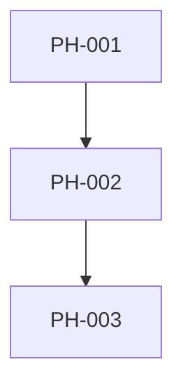

# Backlog template

The backlog is the implementation tracking source of truth. Use the following structure and wording, adapting placeholders.

## Required header

```markdown
# <Project> — <Feature> Backlog

This file **is** the ticket system for <project_name>. `AGENTS.md` points here as the source of truth for implementation tracking. See `AGENTS.md` for the status lifecycle, the definition of done, and the slicing rules.

- **Requirement IDs** come from `<PRD filename>` and `<ADR filename>`.
- Tickets are **vertical slices**: each is demoable and testable on its own (data → domain → authz → API → minimal UI), not a horizontal layer.
- **Statuses:** `TODO`, `IN PROGRESS`, `IN REVIEW`, `DONE`, `BLOCKED`, `DROPPED`.
- Every ticket lists **success criteria** and **tests**. A ticket is DONE only when its success criteria hold locally **and** in CI (both environments) and its tests pass.
- Log entries: append `- YYYY-MM-DD <status>: <note>` under the ticket's `Log`. Never delete a ticket; mark dropped scope `DROPPED` with a reason.
- **Archive:** <describe completed/archive scope>. Full ticket specifications, logs, phase notes, dependency graphs and traceability tables for archived work are in `docs/backlog-archive.md` (read only for past reasoning, never to find work). When a ticket here becomes DONE, move its whole block to the archive in the same PR and leave its row in the snapshot.
```

If this is a brand-new project with no archive yet, state: `Archive: none yet; create docs/backlog-archive.md when the first ticket is archived.`

## Required sections in order

1. **Status snapshot**
2. **Phase overview**
3. **Dependency graph**
4. **Ticket template**
5. **Open tickets from earlier phases** (omit only if there are none, and explicitly state “None.”)
6. **Phase descriptions and constraints**, containing the tickets for each phase
7. **Scenarios → ticket traceability**
8. **Requirements → ticket coverage**
9. **Open questions affecting the backlog**
10. **Notes and deferred items**

## Status snapshot

```markdown
## Status snapshot

| Ticket | Title | Phase / Release | Status |
|---|---|---|---|
| PH-001 | ... | Phase 1 / R1 | TODO |
```

Rows for DONE tickets remain in this table even after their full blocks move to the archive.

## Phase overview

```markdown
## Phase overview

| Phase | Goal | Tickets | Exit criteria |
|---|---|---|---|
| 1 | ... | PH-001–PH-005 | A vertical capability is demoable... |
```

Use explicit exit criteria, not “tickets completed”.

## Dependency graph

Use Mermaid if supported by the target repository; otherwise a fenced text graph. Keep it understandable.



Then list critical path and parallelisable groups in bullets.

## Ticket template

Use this exact semantic structure for all new/open feature tickets:

```markdown
### PH-XXX — Title
- **Phase:** N · **Status:** TODO · **Depends on:** PH-YYY / None
- **Requirements:** REQ-ID, ADR-ID · **Scenarios:** S1, S2 / None
- **Story:** As a <role> I want <capability> so that <value>.
- **Slice:** <what is demoable end to end after this ticket>
- **Classification:**
  - **Complexity:** XS / S / M / L / XL
  - **Complexity score:** N/20 — scope N, logic/state N, integration/data N, verification N, uncertainty N
  - **Risk:** Low / Medium / High
  - **Change type:** Bug / Feature / Refactoring / Infrastructure
  - **Modules affected:** N — <module names if known>
  - **Acceptance criteria:** N
  - **Architectural impact:** None / Local / Cross-cutting / New architectural decision
  - **Expected verification effort:** Low / Medium / High — <key suites/environments>
  - **Classification rationale:** <brief explanation of score, risk and any override>
  - **Confidence:** High / Medium / Low
  - **Classification basis:** <PRD/ADR, repository inspection, supplied docs; name evidence>
  - **Execution strategy:** Planner: <model/role> · Implementer: <model/role> · Reviewer: <model/role> · <specialist/human gate or none>
- **Implementation:** <files, tables, ports, routes, screens>. During initial backlog generation, be concrete where architecture/docs make it known. For the designated planning/implementation-detail phase (e.g. Phase 10), expand this into exact repository paths and touched components after inspecting the repo.
- **Success criteria:**
  - ...
- **Tests:**
  - ...
- **Log:**
```

Every ticket starts with an empty Log. Never pre-fill a TODO log with invented work.

The classification block is mandatory for every ticket, including carried-over tickets. Use the five-dimension scorecard, complexity guardrails, confidence rules and routing overrides in `references/slicing-classification.md`. Do not omit a field because repository evidence is unavailable; state `Unknown`/`Not inspected`, reduce confidence where appropriate, and add a discovery step if the uncertainty matters.

### Success criteria vs tests
- **Success criteria** state externally observable or invariant outcomes.
- **Tests** state how those outcomes are verified, naming unit, integration/API, authz/leak, concurrency, migration, E2E, or CI environment tests as appropriate.
- Include local and CI verification where the header requires both.

## Open tickets from earlier phases

For carried-over or discovered work from earlier phases, use this expanded template:

```markdown
### PH-XXX — Title
- **Phase:** N · **Status:** <status> · **Depends on:** ...
- **Requirements:** ...
- **Story:** ...
- **Problem:** <what is incomplete/wrong and evidence>
- **Solution:** <intended correction>
- **Classification:** <use the complete classification block from the ticket template, including score, rationale, confidence and evidence>
- **Execution strategy:** Planner: ... · Implementer: ... · Reviewer: ... · <specialist/human gate>
- **Implementation plan:**
  1. ...
  2. ...
- **Success criteria:**
  - ...
- **Tests:**
  - ...
- **Log:**
  - YYYY-MM-DD <status>: <only real known history>
```

Do not invent earlier-phase tickets merely to fill this section. If no prior backlog/status input is supplied, write `None known from the supplied context.`

## Phase descriptions and constraints

For every phase:

```markdown
## Phase N — <name>

**Goal:** ...

**Constraints:**
- ...

**Exit criteria:**
- ...

### PH-XXX — ...
<exact ticket template>
```

## Scenarios → ticket traceability

```markdown
| Scenario | Description | Implemented / verified by |
|---|---|---|
| S1 | ... | PH-003, PH-006 |
```

Every scenario from the PRD must appear. At least one ticket must own verification of it.

## Requirements → ticket coverage

```markdown
| Requirement | Summary | Tickets | Coverage |
|---|---|---|---|
| REQ-01 | ... | PH-002, PH-003 | Full |
```

Every MUST and SHOULD requirement must appear. MAY requirements may be marked Deferred with a referenced deferred item.

## Open questions affecting the backlog

Only questions whose answer can alter scope, sequencing, architecture or acceptance behavior. Give a proposed default and state which tickets/phases are affected.

## Notes and deferred items

List explicitly excluded/later features, technical debt intentionally deferred, legal/business validation gates, and follow-up ADRs. Link each to requirements or tickets where possible.

## Phase 3 classification readiness

Before declaring this backlog ready for implementation, apply the complete gate in `references/slicing-classification.md`. Record any unresolved blockers here, including low-confidence tickets, uninspected repository assumptions, required specialist reviews, and XL atomicity approvals. If none remain, state `Phase 3 classification gate: PASS`. Do not state PASS when any mandatory check is incomplete.
